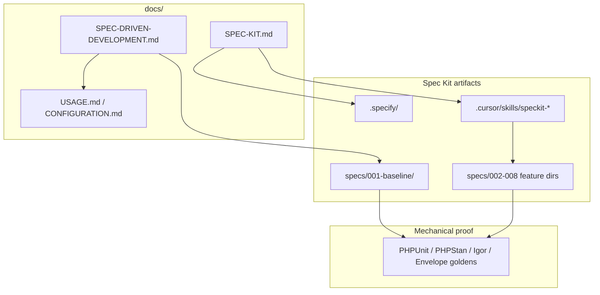

# GitHub Spec Kit — installation, structure, and usage

This manual explains how **GitHub Spec Kit** is set up and used in BeaconBundle. It complements [`SPEC-DRIVEN-DEVELOPMENT.md`](SPEC-DRIVEN-DEVELOPMENT.md) (product behavior, scope and `REQ-*` traceability) and the normative baseline under [`specs/001-baseline/`](../specs/001-baseline/).

**Official upstream docs:** [github/spec-kit](https://github.com/github/spec-kit) · [Spec Kit documentation](https://github.github.io/spec-kit/)

---

## Table of contents

- [Purpose — what Spec Kit adds](#purpose--what-spec-kit-adds)
- [Prerequisites — install Specify CLI](#prerequisites--install-specify-cli)
- [Initialize Spec Kit in this repository](#initialize-spec-kit-in-this-repository)
- [Folder and document structure](#folder-and-document-structure)
  - [`.specify/` vs `specs/` — do not confuse them](#specify-vs-specs--do-not-confuse-them)
- [How the layers fit together](#how-the-layers-fit-together)
- [Baseline backfill (`specs/001-baseline/`)](#baseline-backfill-specs001-baseline)
- [Using Spec Kit in Cursor Agent](#using-spec-kit-in-cursor-agent)
  - [Core workflow (new feature)](#core-workflow-new-feature)
  - [Example — start a feature spec](#example--start-a-feature-spec)
  - [Example — baseline maintenance (manual)](#example--baseline-maintenance-manual)
  - [Skills reference](#skills-reference)
- [Incremental features (`002+`)](#incremental-features-002)
- [Maintainer checklist](#maintainer-checklist)
- [Troubleshooting](#troubleshooting)
- [See also](#see-also)

## Purpose — what Spec Kit adds

GitHub Spec Kit is a **spec-driven development toolkit**. In BeaconBundle it provides:

1. **Versioned scaffolding** (`.specify/`, Cursor skills) so the repository uses the same workflow as the other Nowo bundles (Specify CLI **0.12.5**, see `.specify/init-options.json`).
2. **Baseline specifications** (`specs/001-baseline/`) that document **100% of the production code** under `src/`.
3. **Feature specifications** (`specs/002-…` to `specs/008-…`) for the features added after the baseline: the Symfony 8 demo, the connection test command, Messenger observability, deploy markers, the self-test, Scheduler check-ins and Messenger remote retry.
4. **Cursor Agent skills** (`/speckit-specify`, `/speckit-plan`, …) to author new feature specs, plans and tasks consistently.

Spec Kit does **not** replace PHPUnit, PHPStan, the Envelope golden fixtures or the integrator docs — it **anchors** them. The product contract itself lives in [`specs/001-baseline/spec.md`](../specs/001-baseline/spec.md) and in [`SPEC-DRIVEN-DEVELOPMENT.md`](SPEC-DRIVEN-DEVELOPMENT.md); this manual is tooling documentation only.

---

## Prerequisites — install Specify CLI

Install the **official** Specify CLI from GitHub. Do not install unrelated PyPI packages named `specify-cli` or `specify`: they are not GitHub Spec Kit.

**Option A — persistent install (recommended for maintainers):**

```bash
uv tool install specify-cli --from git+https://github.com/github/spec-kit.git
specify --version
```

**Option B — one-off via uvx:**

```bash
uvx --from git+https://github.com/github/spec-kit.git specify --version
```

Verify:

```bash
specify check
```

You should see **Cursor** listed as an available integration (`cursor-agent`).

---

## Initialize Spec Kit in this repository

Run from the **repository root** (same level as `composer.json`):

```bash
specify init --here --force --integration cursor-agent --script sh
```

| Flag | Purpose |
| --- | --- |
| `--here` | Initialize inside the existing repository (no new directory) |
| `--force` | Merge into a non-empty tree without prompts |
| `--integration cursor-agent` | **Cursor Agent** (mandatory for Nowo bundles) |
| `--script sh` | POSIX shell helper scripts (Linux / macOS / WSL) |

In CI or headless shells, add `--ignore-agent-tools`.

**Verify after init:**

```bash
specify integration list
```

Expected: **Cursor** (`cursor-agent`) → `installed (default)`.

Expected files:

- `.specify/init-options.json` — `"integration": "cursor-agent"`, `"script": "sh"`, `"feature_numbering": "sequential"`
- `.specify/integrations/cursor-agent.manifest.json` and `.specify/integration.json`
- `.cursor/skills/speckit-specify/SKILL.md` (and the sibling `speckit-*` skills)
- `.specify/memory/constitution.md` — BeaconBundle principles (already tailored; keep it when re-initializing)

**Re-init** (refresh skills and templates after upgrading Specify CLI) uses the same command. Existing `constitution.md` and `specs/` are preserved when possible; review the diff before committing.

---

## Folder and document structure

```
BeaconBundle/
├── .specify/                         # Spec Kit infrastructure (how to work)
│   ├── init-options.json             # integration: cursor-agent, script: sh
│   ├── integration.json              # installed integrations
│   ├── integrations/                 # integration manifests
│   ├── memory/constitution.md        # BeaconBundle principles
│   ├── scripts/bash/                 # helper scripts used by the skills
│   ├── templates/                    # spec / plan / tasks / checklist / constitution templates
│   └── workflows/                    # bundled speckit workflow
├── .cursor/
│   ├── mcp.json                      # Engram MCP (REQ-IDE-001)
│   ├── rules/                        # Cursor rules pack (REQ-IDE-003)
│   └── skills/speckit-*/             # Cursor Agent skills (/speckit-specify, …)
├── specs/                            # written specifications (what the product does)
│   ├── 001-baseline/
│   │   ├── spec.md                   # full-product baseline (US / FR / SC)
│   │   └── code-inventory.md         # 100% src/ file → FR-* map
│   ├── 002-solo-symfony8-demo/       # spec.md + checklists/requirements.md
│   ├── 003-connection-test-command/
│   ├── 004-messenger-observability/
│   ├── 005-deploy-markers/
│   ├── 006-self-test/
│   ├── 007-scheduler-check-ins/
│   └── 008-messenger-remote-retry/
└── docs/
    ├── SPEC-DRIVEN-DEVELOPMENT.md    # behavior, scope, REQ-* traceability
    ├── SPEC-KIT.md                   # this manual
    ├── USAGE.md / CONFIGURATION.md   # integrator docs
    └── ENGRAM.md                     # org checklist pointers
```

### `.specify/` vs `specs/` — do not confuse them

| Path | Role |
| --- | --- |
| **`.specify/`** | **How** to work — templates, scripts, constitution, integration metadata. Created by `specify init`. Never put product specs here. |
| **`specs/`** | **What** the product does — the specifications you write and version. Baseline in `001-baseline/`; each feature gets the next number. |
| **`docs/SPEC-DRIVEN-DEVELOPMENT.md`** | Human entry point for **behavior**: user stories, scope and non-goals, validation, `REQ-*` anchors. |
| **`docs/SPEC-KIT.md`** | Human entry point for **tooling** — install, init, structure, Cursor usage (this file). |

---

## How the layers fit together



When you change **product behavior**:

1. Update `specs/001-baseline/spec.md` (or the relevant `00N-feature/spec.md`).
2. Update `specs/001-baseline/code-inventory.md` when files are added, removed or change role under `src/`.
3. Update `docs/USAGE.md` / `docs/CONFIGURATION.md` when integrators must act, and `docs/CHANGELOG.md` / `docs/UPGRADING.md`.
4. Add or adjust **tests** — specs alone are not proof. Envelope shape changes also update `tests/Contract/fixtures/envelope/` (and `make check-envelope-goldens` against Symfony Beacon).

---

## Baseline backfill (`specs/001-baseline/`)

| File | Content |
| --- | --- |
| `spec.md` | Summary, goals, non-goals, user stories with Given / When / Then acceptance, `FR-*` grouped by domain, success criteria `SC-*`, validation commands |
| `code-inventory.md` | One row per production file under `src/`, grouped by category, with semantic `FR-*` IDs, a coverage summary and a `Last audited` date |

**Production code scope:** every file under `src/` (PHP classes and `src/Resources/config/services.yaml`). `tests/`, `demo/` and generated caches are excluded.

**Audit command (maintainers):**

```bash
find src -type f | wc -l
```

The **Total production sources** row in `code-inventory.md` must match this count. BeaconBundle's baseline inventory covers **97/97** files (96 PHP + `services.yaml`) — see [`specs/001-baseline/code-inventory.md`](../specs/001-baseline/code-inventory.md).

---

## Using Spec Kit in Cursor Agent

Open the repository root in **Cursor** and use **Cursor Agent**. Spec Kit installs the skills under `.cursor/skills/`; invoke them as slash commands in the agent chat. Contributor settings for the chat (Ctrl+Enter submit, queued follow-ups) are in [`CONTRIBUTING.md`](CONTRIBUTING.md#cursor-agent-req-ide-006).

### Core workflow (new feature)

Typical order for a **new feature** (not baseline maintenance):

| Step | Skill | Purpose |
| ---: | --- | --- |
| 1 | `/speckit-constitution` | Align or amend `.specify/memory/constitution.md` |
| 2 | `/speckit-specify` | Create `specs/NNN-feature-name/spec.md` from a natural-language description |
| 3 | `/speckit-clarify` | *(optional)* Resolve ambiguities before planning |
| 4 | `/speckit-plan` | Generate `plan.md` (technical approach) |
| 5 | `/speckit-checklist` | *(optional)* Requirements-quality checklist |
| 6 | `/speckit-tasks` | Break the plan down into `tasks.md` |
| 7 | `/speckit-analyze` | *(optional)* Cross-artifact consistency check |
| 8 | `/speckit-implement` | Execute the tasks |
| 9 | `/speckit-converge` | Compare code vs artifacts; append remaining work |

### Example — start a feature spec

```text
/speckit-specify Send a heartbeat item from long-running Messenger workers so Beacon can alert when a worker stops
```

The skill creates the next sequential directory (here `specs/009-…/spec.md`) from `.specify/templates/spec-template.md`.

### Example — baseline maintenance (manual)

To document **existing** code, edit directly:

- [`specs/001-baseline/spec.md`](../specs/001-baseline/spec.md)
- [`specs/001-baseline/code-inventory.md`](../specs/001-baseline/code-inventory.md)

Use `/speckit-converge` after large refactors to list gaps between specs and code.

### Skills reference

| Skill | When to use |
| --- | --- |
| `/speckit-constitution` | Establish or amend project principles |
| `/speckit-specify` | New or updated feature specification |
| `/speckit-clarify` | Before plan — reduce ambiguity |
| `/speckit-plan` | Implementation plan from a spec |
| `/speckit-checklist` | After plan — requirements quality |
| `/speckit-tasks` | Actionable task list from the plan |
| `/speckit-analyze` | After tasks — consistency report |
| `/speckit-implement` | Execute implementation tasks |
| `/speckit-converge` | Post-implementation gap analysis |
| `/speckit-taskstoissues` | Export tasks to GitHub issues |

---

## Incremental features (`002+`)

| Directory | Role |
| --- | --- |
| `specs/001-baseline/` | **Authoritative full-product** spec; later specs must not contradict it |
| `specs/002-solo-symfony8-demo/` … `specs/008-messenger-remote-retry/` | One feature each: `spec.md`, optionally `plan.md`, `tasks.md`, `checklists/` |
| `specs/009-…` | Next feature (sequential numbering, `.specify/init-options.json` → `feature_numbering`) |

When a feature ships:

1. Reference it from `001-baseline/spec.md` (goals, user stories, `FR-*` pointer rows) when it becomes core product surface.
2. Add its new `src/` files to `code-inventory.md`.
3. Update integrator docs, CHANGELOG / UPGRADING and tests.

---

## Maintainer checklist

Before merging a PR that changes production code:

- [ ] `specs/001-baseline/code-inventory.md` lists every new or changed file under `src/`, and the total matches `find src -type f | wc -l`
- [ ] `specs/001-baseline/spec.md` (or the feature spec) describes the behavior with `FR-*` / `SC-*` IDs
- [ ] `docs/SPEC-DRIVEN-DEVELOPMENT.md` user stories, scope, non-goals and `REQ-*` table are still accurate
- [ ] `docs/USAGE.md` / `docs/CONFIGURATION.md` updated when integrators are affected
- [ ] Envelope goldens updated when an Envelope shape changed
- [ ] `make qa` (or `composer qa`), `make phpstan`, `make igor` and `make test-coverage-100` pass
- [ ] `.specify/memory/constitution.md` updated when principles changed

Migrating another bundle to Spec Kit (for reference):

- [ ] Install Specify CLI
- [ ] `specify init --here --force --integration cursor-agent --script sh`
- [ ] Create `specs/001-baseline/{spec.md,code-inventory.md}` and tailor `constitution.md`
- [ ] Add `docs/SPEC-KIT.md` and extend `docs/SPEC-DRIVEN-DEVELOPMENT.md`
- [ ] Link **GitHub Spec Kit** from the root `README.md` `## Documentation`

---

## Troubleshooting

| Problem | Action |
| --- | --- |
| `Unknown integration: 'cursor'` | Use `cursor-agent`, not `cursor`: `--integration cursor-agent` |
| Skills missing in Cursor | Re-run `specify init --here --force --integration cursor-agent --script sh`; confirm `.cursor/skills/speckit-specify/` exists |
| `specify integration list` shows Cursor not installed | Run init from the repository root; check `.specify/integration.json` |
| Agent cannot find `.specify/` | Open Cursor at the **repository root**, not `demo/symfony8` or another subfolder |
| A new spec lands in `.specify/` | Wrong directory — move it to `specs/NNN-name/`; `.specify/` only holds tooling |
| Inventory count mismatch | Run `find src -type f \| wc -l`, add the missing rows and update the coverage summary in `code-inventory.md` |
| Re-init overwrote `constitution.md` | Restore it from git (`git checkout -- .specify/memory/constitution.md`) |

---

## See also

- [`SPEC-DRIVEN-DEVELOPMENT.md`](SPEC-DRIVEN-DEVELOPMENT.md) — product behavior, scope and `REQ-*` traceability
- [`specs/001-baseline/spec.md`](../specs/001-baseline/spec.md) — baseline functional spec
- [`specs/001-baseline/code-inventory.md`](../specs/001-baseline/code-inventory.md) — 100% code map
- [`.specify/memory/constitution.md`](../.specify/memory/constitution.md) — project principles
- [`CONTRIBUTING.md`](CONTRIBUTING.md) — local workflow and Cursor Agent settings
- [GitHub Spec Kit documentation](https://github.github.io/spec-kit/) — upstream Specify CLI and skills reference
